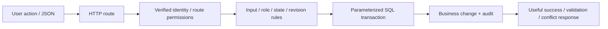

# API Business Logic and Reliable Workforce Processes

**Make sure a business change is allowed, accurate and based on the latest information.**

[Business problem](#the-business-problem) · [Solution](#the-solution) · [Strengths](#engineering-strengths) · [Proof](#proof-it-works) · [Commands](docs/COMMANDS.md)


## The Business Problem

Staff may enter an invalid pay rate, lack permission to approve a change, or act on information someone else has already updated. A payroll draft may also contain important earlier edits even when its latest version looks empty. The application must catch these cases before changing or deleting records.

## The Solution

Put the business rules on the server, where users cannot bypass them by changing the page. Check the requested change, the person’s permissions and the record’s version before saving. This project uses real wage and payroll-draft rules with fictional examples.

**Business outcome:** The example blocks unauthorized or out-of-date approvals and avoids treating meaningful payroll work as an empty draft.

## Engineering Strengths

| Strength | Practical value |
| --- | --- |
| **Rules stay testable** | Pure rules can be checked without an HTTP server, Azure login or live database. |
| **Conflicts are explicit** | A out-of-date record version or decision that is no longer awaiting approval returns a conflict instead of silently overwriting newer work. |
| **Data meaning is preserved** | Draft classification examines every saved version and treats unknown shapes conservatively. |

## Architecture



This project is derived from actual workforce-platform implementation. Identifying labels/targets use examples. The local viewer and demonstration are new reference code; [source mapping](docs/SOURCE-MAP.md) identifies the copied/extracted files and limitations.

## What Was Built

| Component | Purpose | Implementation |
| --- | --- | --- |
| Actual extracted wage rules | Validate money/date/action fields, role combination and version still awaiting a decision | [Rules](src/wageRules.ts) |
| Actual draft classifier | Examine every payroll snapshot; refuse unknown/incorrectly structured shape | [Source](src/payrollPacketDiscard.ts) |
| Actual route reference | Authorization before store, JSON/body limits and useful failures | [Route](reference/wagechanges-route.ts) |
| Actual SQL store reference | Serializable transaction, locking, parameterized queries and audit | [Store](reference/wageChanges.ts) |
| Local demonstration | Exercise actual rule/evaluation code using fictional data | [Demo](scripts/demo.py) |
| Dated context | Keep recorded implementation separate from new local evidence | [Context](data/history.json) |

## Proof It Works

### 1. Run focused checks

```bash
node --experimental-strip-types --test src/payrollPacketDiscard.test.ts src/wageRules.test.ts
node --experimental-strip-types src/example.mjs
python -B scripts/demo.py
```

**Observed:** Ten Node tests passed: two original discard tests and eight new focused tests over the actual extracted wage rules. [Validation](docs/VALIDATION.md) records the exact scope and distinguishes pure/mock checks from testing with the hosted services.

### 2. Inspect the decision output


The output is explicitly fictional and exercises the included logic. A successful rule test or simulation is not a completed real-world operation. The public example runs standalone rules and reports errors. It does not verify login credentials, connect to SQL, test competing requests across servers or complete payroll.

### 3. Open the reference viewer

```bash
python -B scripts/preview.py --port 8139
```

Open [the local reference](http://127.0.0.1:8139). Switch between Overview, Working example and Implementation context. Ctrl+C stops it. Screenshots are genuine local captures, not hosted application/Azure Portal screenshots.

## What Business Logic Means Here

Business logic is the set of rules that gives a request meaning: who can approve a wage change, what a valid rate/date looks like, which revision may still be changed and whether a saved payroll draft contains work worth preserving. An API route exposes that action over HTTP; SQL persists the accepted result; the frontend explains and requests the action.

The actual wage route authenticates/authorizes before opening the store, separates self-service current pay from staff operations, restricts content type/body size/fields and maps known errors to useful responses. Its Functions authLevel=anonymous means the app's own verified role middleware is responsible for authorization; it does not mean the business action is public.

The extracted rules require a positive decimal rate with at most two decimal places and a real date. Approval requires Admin or HR together with Payroll. The row must still be pending at the record version supplied in the request. Invalid input is 400, wrong permission is 403 and stale state is 409. An unexpected store failure asks the user to reload history before retrying because a save result may be uncertain.

The full database code checks the saved history again before changing it. It uses SQL queries that keep user values separate from query instructions, and database locks that prevent competing changes. It then saves an audit record. Record IDs and version checks help prevent duplicates and outdated changes. The standalone rule tests do not test these database and retry steps.

The draft classifier checks all versions. Earlier lines, payment changes, secure details or meaningful notes make the packet a draft even when the latest version has no hours. Unknown/incorrectly structured snapshots return unknown rather than being classified safe to discard.


## Operations, Limits and Growth

State clearly which system is being checked, who owns it and what the result actually proves. Test the cases that should be denied or rejected as well as the successful ones. Keep incomplete results clearly marked. Preserve private inputs and unrelated changes. Before expanding the design, measure what is slow or limited, review costs, and check access restrictions and recovery again. [Operations and scaling](docs/OPERATIONS-AND-SCALING.md).

## Project Guides

| Guide | Purpose |
| --- | --- |
| [Implementation](docs/IMPLEMENTATION.md) | Rules, boundaries and actual source design |
| [Commands](docs/COMMANDS.md) | Local tests, expected output and inspection |
| [Operations and scaling](docs/OPERATIONS-AND-SCALING.md) | Strengths, weaknesses, costs and growth |
| [Source map](docs/SOURCE-MAP.md) | Actual files and public adaptations |
| [Validation](docs/VALIDATION.md) | Observed local evidence and remaining integration scope |

No Azure service, business record or live state was changed. The public validation workflow is manual-only and was not dispatched, conserving hosted Actions minutes.
